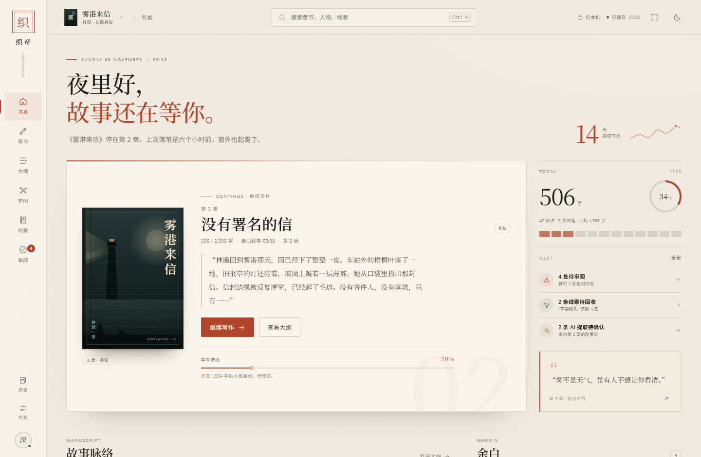
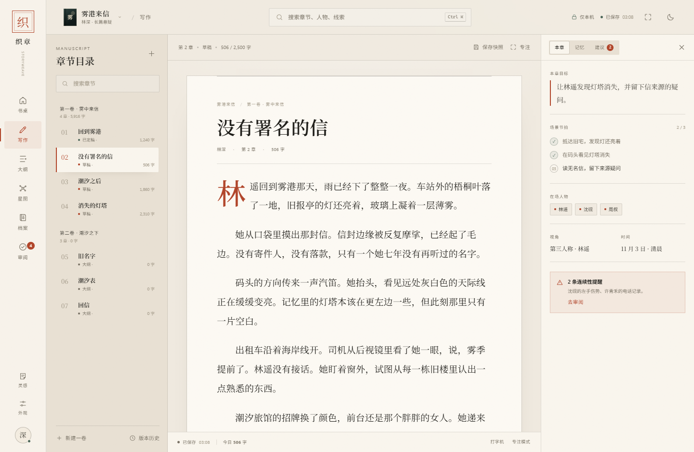
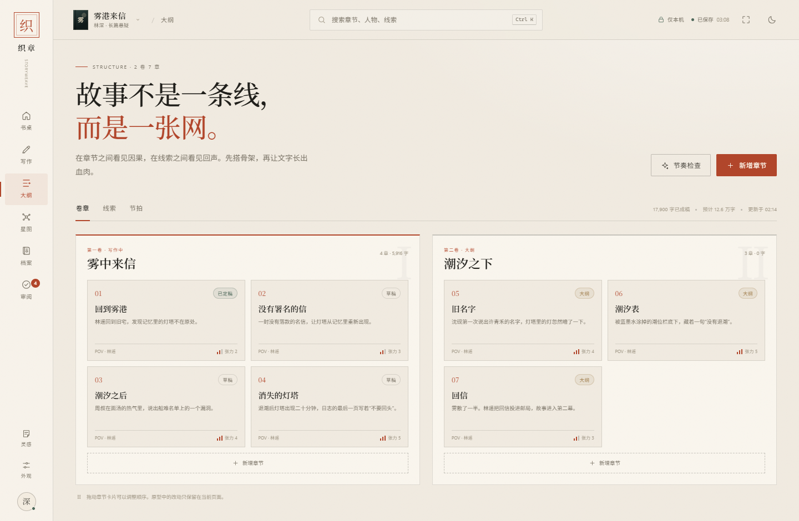
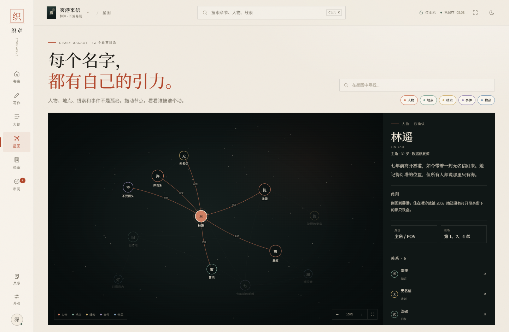
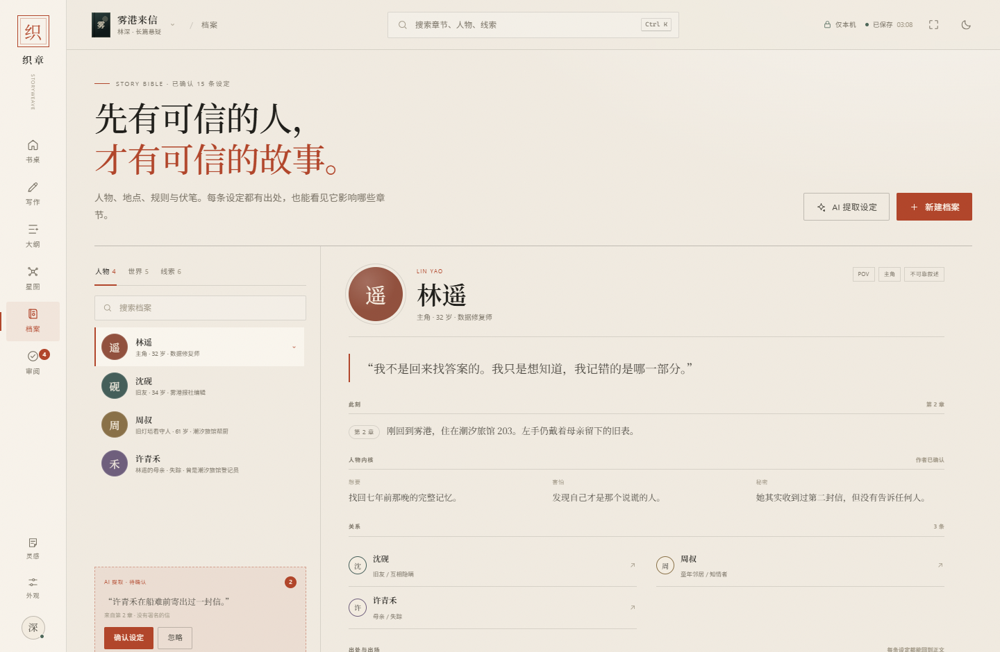
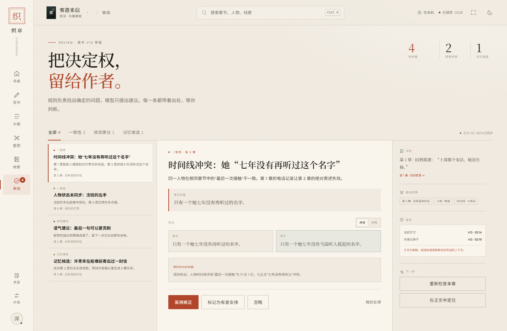
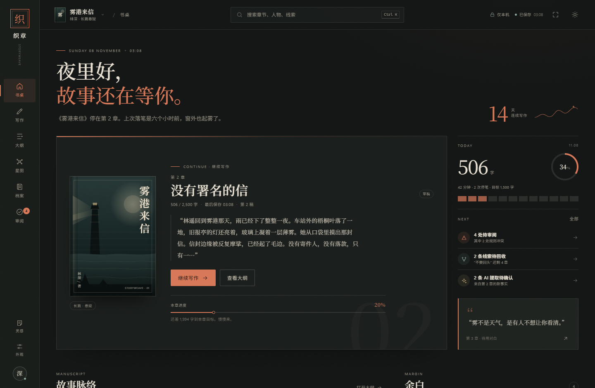
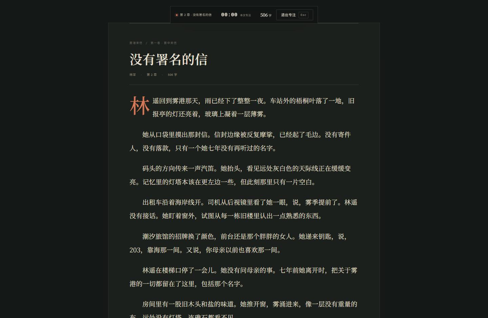
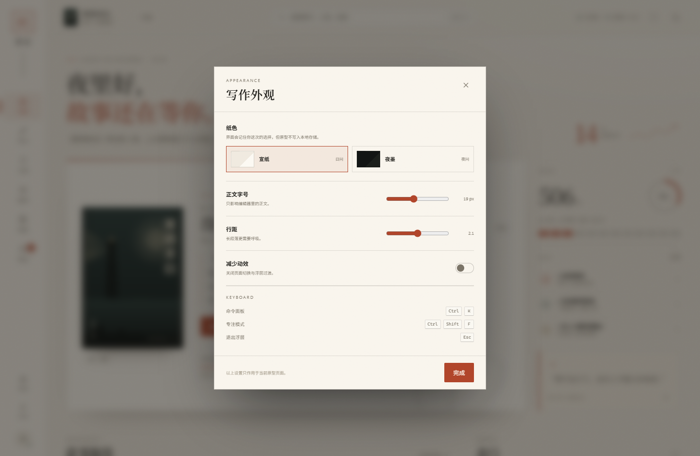

# 织章 · StoryWeave — UI v5「纸页与星图」

日期：2026-11-08（Asia/Shanghai）。独立视觉与交互原型，不改动 `src/` 正式 renderer，不接入 Electron 主进程、数据库或模型服务。

用 Chrome 或 Edge 直接打开 [index.html](index.html)。不需要安装依赖、启动开发服务或联网；`index.html`、`styles.css`、`app.js` 三个文件即可离线浏览。

## 为什么重做一版

现有苹果风格工作台清晰、克制，但更接近通用效率软件：浅灰导航、蓝色主操作、统计卡与风景图放在一起，能完成工作，却不太像“写小说的地方”。这一版把界面重新放回一张书桌：

- 文字是主角，工具栏退到页边；
- 目录像书，工具像桌，不像后台仪表盘；
- AI 是页边的一份提议，不是覆盖正文的聊天窗口；
- 保留苹果风格的清楚层级和可用性，但拿掉通用蓝，换成宣纸、墨与朱砂。

## 预览

| 书桌 | 写作 |
| --- | --- |
|  |  |
| **大纲 · 卷章** | **星图** |
|  |  |
| **档案** | **审阅** |
|  |  |

| 夜墨模式 | 专注模式 | 写作外观 |
| --- | --- | --- |
|  |  |  |

手机端见 `mobile-desk.png`、`mobile-write.png`、`mobile-outline.png`、`mobile-galaxy.png`、`mobile-archive.png`、`mobile-review.png`；[书桌完整长图](desk-full.png)、[大纲节拍](outline-beats.png)、[命令面板](palette.png)。

## 视觉语言

| 角色 | 取值 | 用法 |
| --- | --- | --- |
| 宣纸 | `#F1EBE1` / 纸面 `#FDFAF4` | 工作区底色与正文纸面 |
| 墨 | `#201F1B` | 正文、标题与主要控件 |
| 朱砂 | `#B2462B` | 主操作、当前章节、关键数字；全局只保留一个强调色 |
| 松烟 | `#4E685A` | 已确认、完成、记忆状态 |
| 旧金 | `#A17E4D` | 计划中、伏笔、待回收 |
| 夜墨 | `#121514` / 纸面 `#1C201C` | 夜间主题；纸面仍是“被灯照亮的一页” |

- 中文标题与正文使用本机 `Noto Serif SC`，回退宋体；界面文字使用 `Segoe UI` / `Noto Sans SC`。没有下载字体。
- 页面使用 1px 细线、极浅纸纹、低对比阴影，不堆叠玻璃拟态和高饱和渐变。
- 《雾港来信》的封面、灯塔、月亮、雾线，以及星图的星点与关系线，全部是原创 CSS / SVG，没有复制第三方封面或截图。
- 竖排书名、朱砂印章、页码与 folio 标记来自中文书籍的排版习惯，但控件仍是现代屏幕尺寸。

## 页面结构

```text
96px 图标栏  │ 顶栏：当前作品 / 页面 / 全局搜索 / 本地状态 / 专注 / 纸色
             │
             │ 书桌 · 写作 · 大纲 · 星图 · 档案 · 审阅
             │
             │ 写作页：章节目录 252px │ 纸面 1fr │ 本章与建议 318px
```

桌面保留 96px 图标栏，把横向空间还给正文；作品与页面上下文放在顶栏。窄屏时图标栏变为底部导航，写作目录与建议改为抽屉。

## 六个页面

### 书桌

- 继续写作的主卡：封面、章节、摘录、进度与“继续写作”；
- 今日字数与目标环、待审阅 / 伏笔 / AI 候选；
- 故事脉络、余白便笺与书架；
- 便笺可以直接新增，不会自动进入正文；
- 书架只展开《雾港来信》，其他作品保留封面与状态。

### 写作

- 章节目录、卷分组、搜索与字数；
- 纸面编辑器支持直接输入、中文首字下沉、章节切换、自动保存状态；
- 选中文字会出现浮动工具栏：加粗、斜体、下划线、高亮、问 AI；
- 右侧边栏分“本章 / 记忆 / 建议”；
- 建议可以“替换”或“忽略”，支持撤销；续写是固定演示，标注“未连接模型”；
- “专注模式”隐藏导航与边栏，只留纸面、计时与字数；`Esc` 退出；
- “打字机”收窄纸面，让视线落在句子上。

### 大纲

- **卷章**：两卷 7 章的卡片板，显示状态、POV、摘要与张力；卡片可拖动排序；点击打开章节抽屉；
- **线索**：灯塔真相、林遥 × 沈砚、无名信、“不要回头”、周叔的记忆五条线穿过 7 章；
- **节拍**：张力曲线 + 七拍列表，点击节点可以查看节拍说明；
- “新增章节”会真实加入当前页面的目录与卡片板。

### 星图

- 深色“星图板”嵌在纸色工作区里，12 个故事对象按类型着色；
- 点击节点查看人物 / 地点 / 线索 / 事件 / 物品档案、关系与出处；
- 拖动节点、平移画布、滚轮缩放、按钮缩放、类型筛选、搜索定位；
- 选中节点时其他对象自动退后，相关边线亮起；
- 手机端提供两列故事对象列表，点按即可打开详情，不依赖精确点中星点。

### 档案

- 人物 / 世界 / 线索三个分类，15 条已确认设定；
- 详情包含“此刻”、人物内核、关系、出处与出场；
- 关系行可以跳转到另一条档案；
- AI 提取候选在底部单独列出，必须由作者确认或忽略；
- 确认候选会真实加入线索列表与当前页面计数。

### 审阅

- 顶部显示待处理 / 规则冲突 / 记忆候选数量；
- 左侧队列、中央差异、右侧出处与影响；
- 规则冲突与模型建议明确区分；
- 支持并排 / 行内两种差异视图；
- “采用修正”会改写当前章节正文并更新字数，可撤销；
- “标记为有意安排”“忽略”“稍后处理”都不会静默改正文；
- 处理完所有问题后出现“今日已审”的空状态。

## 全局交互

- `Ctrl / Command + K`：命令面板，可搜页面、章节、人物和动作；上下键选择，回车执行；
- 顶栏作品切换、纸色切换、专注模式；
- 外观弹窗：宣纸 / 夜墨、正文字号、行距、减少动效；
- 所有数据只保存在当前页面的 JavaScript 内存，刷新即还原；
- 浏览器宽度 1440 / 1280 / 1024 / 820 / 390 均无横向溢出。

## 调研与取舍

| 参考 | 我们采用的部分 | 没有采用的部分 |
| --- | --- | --- |
| [iA Writer](https://ia.net/writer) | 文字优先、专注模式、工具栏退后 | 极简到没有目录和侧栏；本项目需要章节与记忆 |
| [Ulysses](https://ulysses.app/) | 作品—章节—正文的层级、目标与写作统计 | 以 Markdown 为中心的发布流 |
| [Bear](https://bear.app/) | 温暖纸色、安静的排版、主题切换 | 笔记优先的标签结构 |
| [Novelcrafter](https://www.novelcrafter.com/) | AI 辅助与故事资料并存 | 用聊天或自动生成替代作者判断 |
| [Apple HIG](https://developer.apple.com/design/human-interface-guidelines/) | 侧栏层级、工具栏分组、清晰状态、减少动态 | 默认蓝主操作与通用系统面板的视觉气质 |
| 本地 [视觉参考索引](../references/README.md) | Obsidian 主题的强调色、星图构图、暗色关系视图 | 第三方主题素材与品牌元素 |

另外参考了中文书籍的竖排书名、朱砂印章、页码与留白习惯。网络资料只用于设计观察，没有复制第三方界面素材；样章《雾港来信》、人物、封面与星图内容均为原创演示内容。

## 验证

2026-11-08 使用本机 Chrome headless 打开 `file://` 页面：

- 46 项浏览器检查全部通过：导航、命令面板、章节切换、便笺、外观弹窗、正文建议采纳、审阅采纳与撤销路径、档案候选、章节新建、星图缩放 / 筛选 / 详情、手机抽屉与手机星图列表；
- `pageerror`、`console error`、HTTP(S) 请求均为 0；
- 1440 / 1280 / 1024 / 820 / 390 五种宽度下，六个页面均无横向溢出；
- 截图保存在本目录；检查过程截图与完整结果见 [validation.json](validation.json) 和 `checks/`。

未运行 Electron 正式应用、构建、测试或真实模型请求；未在原生手机、平板、真实触摸手势或屏幕阅读器上验证。窄屏为响应式布局，不代表原生移动端验收。

## 明确边界

- 这是页面与交互原型，不是正式功能实现。所有保存、版本、AI 建议、记忆、检索与任务状态都是页面内演示；
- 刷新或关闭会还原，没有 localStorage、数据库或真实文件写入；
- 《雾港来信》之外的书籍只有封面与状态；书架管理、档案编辑、新建作品等入口保留为提示；
- 没有修改 `src/`、正式 renderer 或现有文档；正式应用的能力与证据仍以[开发进度](../../docs/开发进度/README.md)和[技术架构](../../docs/技术架构/README.md)为准。
