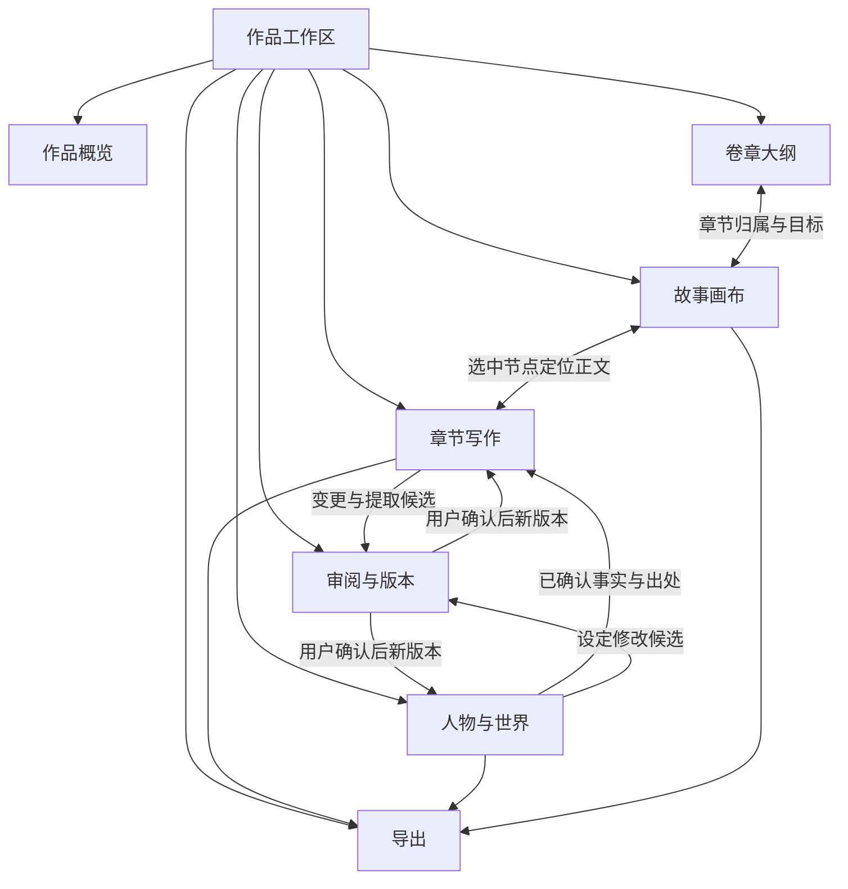
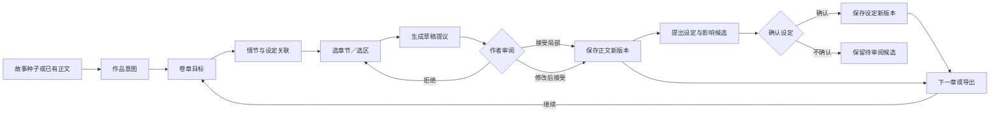
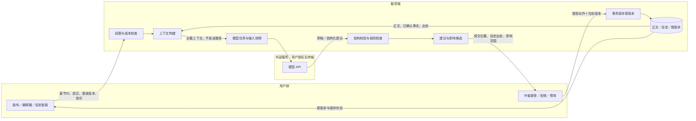
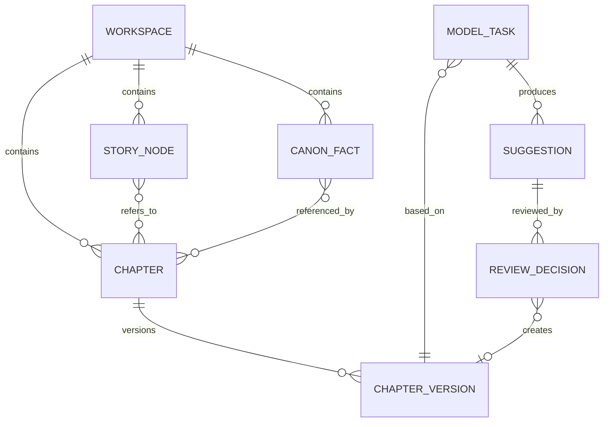
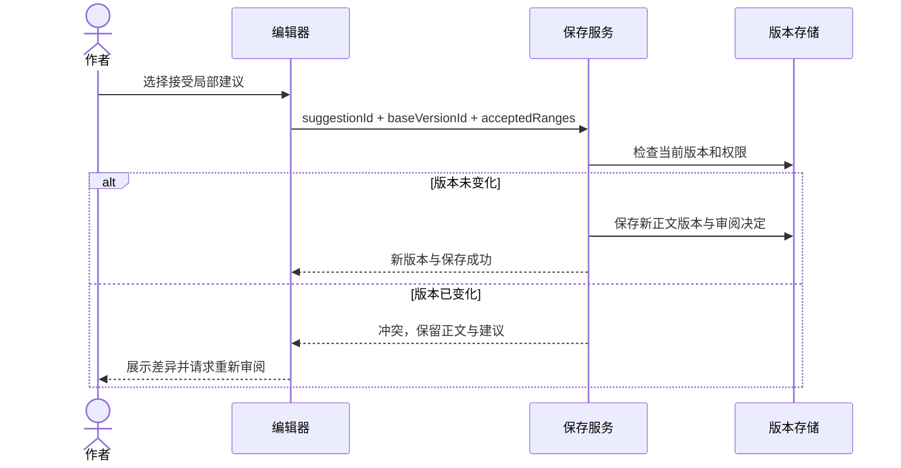

# 织章：模块、业务流程与数据流

> 历史设计基线：2026-11-03 初始提交 `434d4f5`；原路径 `docs/03-flows.md`。恢复归档日期：2026-11-06。本文保留当时的目标设计，不代表当前实现或验收结果；当前状态见[开发进度](../开发进度/README.md)，交互参考见[产品与原型导航](产品设计与原型导航-2026-11-06.md)。

这些图描述正式应用的目标设计，不表示原型已具备服务端、模型调用或可靠保存。可视化版本见 [流程页面](../../prototype/flows.html)。

## 1. 信息架构／模块图

## 2. 创作业务流程／用户旅程

作者可以从编辑器直接写，不强制走全部初始化流程。修改已有设定时，从设定候选进入同一审阅与版本链路。

## 3. 模型任务数据流／DFD

### 数据不变量

- 模型输出先存建议，不直接写入已确认正文／设定。
- 每次生成记录所用正文、设定和画布版本。
- 出现版本冲突时重新审阅，不自动拼接。
- 明确引用关系与模型推测影响分开保存。
- 日志主要记录任务ID、模型、耗时、用量和错误类型；敏感正文默认不写普通日志。

## 4. 核心对象关系

这是关系草图，不是最终数据库DDL。所有对象以作品ID限定范围；建议和事实必须保存来源引用。画布边需要连接类型，不能只保存两端坐标。

## 5. 接受建议时序

