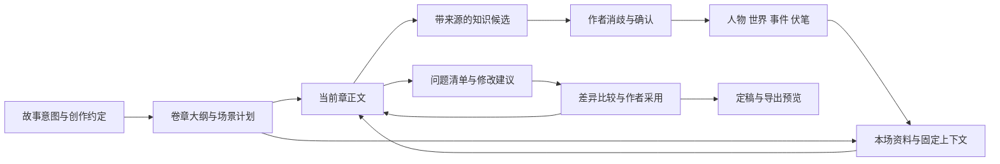

# 小说创作工作台功能与代码复审

日期：2026-11-08（Asia/Shanghai）。对象：当前工作区代码、现有产品设计和公开产品资料。

**结论：已有正文、资料、记忆与恢复基础，下一阶段最有价值的工作是把它们连成“规划这一场 → 写这一章 → 找出问题 → 比较修改 → 定稿交付”的完整流程。** 当前优先缺口是场景规划、作品级创作约定、实体消歧、带证据的改稿和写作时随手查阅资料。本轮另确认两个 P2 行为问题；没有确认新的 P1 缺陷。

本报告为审查结论与产品建议，不是已批准的实施范围，也不是 task-run 实施包。功能建议的“优先／随后”与代码问题的 P2 严重度分开表达。

## 1. 范围与证据口径

- 源码基线：HEAD `b319e460533fe0af0016b96c364ad56dce328504`，**包含工作区尚未提交的界面、记忆类型修正及新增文件**。仅检出该提交不能复现全部审查对象。
- 方法：主审读取产品与架构文档、追踪关键调用链；三个并行 agent 分别核对保存与恢复、AI 与记忆、产品功能与界面；主审再次读取关键发现对应的分支和契约。
- 代码范围：章节与作品生命周期、保存和关闭、恢复包与检查点、AI 消息组装及采用、知识身份、人物认知、卷章规划、资料查阅、历史与导出。属于关键业务链复审，未声称逐行覆盖全仓或证明不存在其他问题。
- 外部调研：查阅八款工具的官方产品页或帮助资料，来源见第 9 节。它们用于识别可借鉴的交互和任务组织，不代表本轮亲自试用了这些产品，也不证明 AI 质量、性能或效果优于本项目。
- 本轮未启动应用、服务或容器，未运行测试、类型检查、编译、构建、打包、迁移或模型请求，未安装依赖、读取凭据或修改业务源码。

“静态确认”表示当前代码能支持所述条件与分支结果；“设计缺口”表示当前模型或流程不能直接完成指定任务；“待验证”表示仍需真实运行或用户试用。已有运行记录只能说明其当时的覆盖范围，本轮没有复跑。

## 2. 当前已经具备什么

| 作者任务 | 当前源码状态 | 当前边界与证据 |
| --- | --- | --- |
| 建立、导入、管理作品 | 已接通主要调用 | 新建、TXT／Markdown 导入、搜索、资料与归档；新建只填写名称。见 [App](../../src/renderer/App.tsx) L343、[资料表单](../../src/renderer/components/EditingDialogs.tsx) L18 |
| 卷章组织 | 已有基础，规划不完整 | 卷章、排序、章节目标／视角／目标字数／备注／状态；没有独立场景对象。见 [章节契约](../../src/contracts/api.ts) L59–119、[目录](../../src/renderer/components/LibraryPanels.tsx) L125 |
| 写作与保稿 | 已有基础 | 正文格式、查找替换、撤销、专注、自动保存、历史、草稿检查点；本轮未重新验证输入法或崩溃。见 [编辑器](../../src/renderer/components/ManuscriptEditor.tsx)、[章节会话](../../src/renderer/hooks/useChapterSession.ts) |
| 人物、世界与故事记录 | 已有结构化资料 | 通用人物／地点／规则条目，以及关系、事件、伏笔、人物认知；详细人物弧线和历史知情仍需补充。见 [知识契约](../../src/contracts/knowledge.ts)、[故事契约](../../src/contracts/story.ts) |
| 故事星海 | 已有只读关联查阅 | 可选择、聚焦、旋转视图，展示本页登记引用；没有节点编排或连线写入。见 [星海](../../src/renderer/components/StoryGalaxyPanel.tsx) L368–413、[视图交互](../../src/renderer/components/StoryGalaxyView.tsx) L122–148 |
| 时间线 | 已有两种顺序 | 故事顺序与披露章节顺序；列表式只读查阅，未知时间不强排，同章不推断段落先后。见 [时间线](../../src/renderer/components/StoryTimelinePanel.tsx) L294–311 |
| 灵感与素材 | 已有书内笔记和转设定 | 三类笔记可编辑、检索，明确操作后转为作者设定；每条必须归属作品，缺少独立收集与结构化拆书。见 [笔记契约](../../src/contracts/notes.ts) L4–33、[转换事务](../../src/infrastructure/notes/notes-repository.ts) L233–264 |
| AI 创作 | 已接通提议与采用 | 规划、续写、改写、摘要、抽取；有固定上下文与版本核对。规划采用主要进入本章备注。见 [AI 契约](../../src/contracts/ai.ts) L13、[采用](../../src/infrastructure/ai/ai-repository.ts) L455 起 |
| 长篇记忆 | 已有多层机制 | 本地检索、向量、逐章整理、分层摘要、上下文推荐、作者／读者／人物范围；这些机制存在不等于长篇准确率已达标。见 [上下文](../../src/infrastructure/ai/context.ts)、[人物范围](../../src/infrastructure/ai/character-context.ts) |
| 改稿和版本 | 局部 | 历史单版预览和整章恢复、候选编辑后采用；缺少两版差异、持久改稿问题清单及局部恢复。见 [版本历史](../../src/renderer/components/RevisionHistory.tsx) L18–72 |
| 定稿、阅读、导出 | 已有基础 | 工作稿／定稿可区分；TXT／Markdown 导出，未形成带目录、前后记及格式预览的出版交付流程。见 [导出表单](../../src/renderer/components/EditingDialogs.tsx) L65–74 |
| 作品恢复包 | 已有实现 | 书内数据库快照和登记的导入原件，校验、预览、完成标记及登记；不包含书库级检查点等全部资产。见 [恢复仓储](../../src/infrastructure/storage/book-recovery-repository.ts) L520 起 |

此前“没有完整恢复包”“没有笔记转设定”“没有时间线或星海”“没有人物视角”等描述已不适用于当前源码。现阶段应审查这些能力的边界与连接方式。

## 3. 新确认的代码行为问题

### C-01｜P2｜业务进程已异常退出时，干净会话仍无法正常关窗

**条件与结果：** 界面已经成功进入正常会话，正文无未保存修改、没有未决操作，随后业务进程异常退出。作者关闭窗口，界面即使确认可以关闭，主进程仍要求已退出的服务完成关闭请求，结果继续保留窗口。

**直接证据：** [service-client.ts](../../src/desktop/main/service-client.ts) L33–38 在退出事件中设置 `exited` 并标记不可用；L46–48 会拒绝请求；L94–107 的 `close()` 没有已退出分支，仍调用 `service.close`。[main/index.ts](../../src/desktop/main/index.ts) L414–427 的豁免仅限“首次加载失败且从未建立会话”，正常会话进入失败提示分支。

**边界：** 服务重启成功后仍可能正常退出；不是所有关窗都失败，也不是旧 SR-05 的首次加载失败问题。没有运行复现或认定丢稿。

**修复建议与验收：** 保留界面保稿、未决写入和模型结果门禁，在确认服务已退出且界面确认没有待保留内容后允许结束窗口。将来验证应覆盖“干净会话可退出”和“有草稿／未确认写入时仍保留”两个相反场景。

### C-02｜P2｜经书架返回写作会丢失当前章节位置

**条件与结果：** 单作品库中打开第十章，进入书架，再点击导航“写作”；会打开该作品第一章。

**直接证据：** [App.tsx](../../src/renderer/App.tsx) L278–279 清空章节与当前作品；L312–315 的 `resumeWriting()` 在此时调用不带章 ID 的 `openBook()`；L250 默认取 `chapters[0]`。

**边界：** 返回首页保留当前会话；首页部分入口会传入最近修改章节。因此并非所有返回路径都错误，也没有证明保存内容丢失。

**修复建议与验收：** 统一记录“最后打开的作品、章节与位置”，与“最近修改”分开；书架返回及重新打开作品优先恢复该位置，目标不可用时再回目录。需覆盖未修改的阅读定位、多作品、归档作品和不存在的章节。

### 旧问题复核

旧 SR-01 至 SR-10 已有对应修复分支，本轮没有将其原触发条件重复计入缺陷：正文异常 UTF-16 拒绝、资料表单关窗保护、拒绝候选绑定身份、模型终态补存、首次加载失败退出、数据库硬链接限制、恢复身份校验、Markdown 强调处理、固定连接摘要采用、新摘要 NUL 拒绝。主审补查 [AiPanel.tsx](../../src/renderer/components/AiPanel.tsx) L796–808 确认拒绝操作比较固定候选与版本；其余由对应 agent 核查当前调用链。**这表示旧缺陷已有静态保护，不表示全部回归场景已经运行通过。**

## 4. 功能设计中最值得优先补齐的部分

### F-01｜优先｜以场景计划连接大纲、正文和情节线

**现状：** 章节有目标和备注，正文有分场线；故事事件描述发生的事，星海描述登记引用，都没有承担“这一场准备怎样写”的职责。AI 规划采用不能直接形成可排序的场景任务。[章节契约](../../src/contracts/api.ts) L59–119、[故事种类](../../src/contracts/story.ts) L8、[AI 面板](../../src/renderer/components/AiPanel.tsx) L1005。

**建议设计：** 先增加跨章大纲表，显示章节目标、视角、计划／当前字数、状态和待解决问题；再提供可选场景卡。默认只问“谁要做什么、遇到什么阻碍、结束时发生什么变化”，人物、地点、故事时间、情节线等按需展开。允许直接写正文，之后补卡。Scrivener 的摘要卡、Plottr 的情节线、Novelcrafter 的场景组织可分别参考〔S1、S2、S3〕。

**数据与交互边界：** 场景计划有稳定身份、所属章节、叙述顺序、目标、冲突和预期变化；实际正文仍通过修订与段落锚点关联。首步保留现有章节保存单位，避免为了卡片重写保稿机制。计划调整不自动移动或重写正文；提供独立的“调整规划顺序”和“调整正文顺序”动作。一个事件可以在多个场景中被回忆或披露，不能强制场景与事件一一对应。

**验收场景：** 先规划一个尚无正文的场景，开始写作后将它关联到正文；正文改动导致锚点无法核对时显示待重连，而不是默默指向别处。

### F-02｜优先｜作品级创作约定必须真正进入 AI 预览

**静态确认：** “作品资料”保存类型与简介，但 [context.ts](../../src/infrastructure/ai/context.ts) L213 只读取标题等字段，L258–268 的实际消息也没有 `genre/synopsis`。仅填写简介，不能使规划与续写自动收到它。作者仍可在本次指令或手选资料中补充，因此这是上下文接线与产品预期缺口。

**建议设计：** 增加轻量“创作约定”：故事前提、目标读者／题材、叙述人称与时态、风格偏好、不可违背的规则。作者决定哪些常驻，发送前能看到实际内容、占用和来源版本。区分给模型的创作要求与角色／读者可知事实；人物模式不能无条件携带含结局的全书简介。

**验收场景：** 更新题材或风格后，新预览明确展示更新；历史候选继续显示生成时的固定约定。使用人物视角时，未来剧情不会因“常驻资料”绕过原范围限制。参考 Story Bible、Codex 的组织方式，不照搬其模型策略〔S3、S4〕。

### F-03｜优先｜抽取采用增加“关联已有实体”和“追加来源”

**静态确认：** [AiMemoryReviewEntry](../../src/contracts/ai.ts) L128 只有候选序号和字段，没有目标实体／采用动作；[ai-repository.ts](../../src/infrastructure/ai/ai-repository.ts) L530–536 每次调用新建；[knowledge-repository.ts](../../src/infrastructure/knowledge/knowledge-repository.ts) L125–127 为其生成新 UUID。不同章节分别抽取并采用同一人物，会产生不同身份。已有同一候选重复采用保护不能处理这个问题。

**建议设计：** 每条抽取结果先显示同名／别名候选，作者选择“新增人物、关联已有条目并追加来源、提出字段修改、忽略”。同名不自动合并，秘密身份不能仅用普通别名展开。冲突内容作为待审建议保留；已有关系、知情和出处持续引用稳定实体身份。

**验收场景：** 两章先后出现同一人物，第二次采用只增加来源；两个同名人物可以保持独立；作者否决字段更新不影响原设定。复用现有知识写入事务、版本和来源机制。

### F-04｜优先｜建立“发现问题—判断—改稿—复核”的审阅流程

**现状：** `AiTaskKind` 只有规划、续写、改写、摘要和抽取；章节的 `review` 状态只是流程标签。通用改写指令可以请求意见，但没有持久化的审稿问题模型。[AI 契约](../../src/contracts/ai.ts) L13、[章节状态](../../src/contracts/api.ts) L76。

**建议设计：** 首版支持作者手工问题和 AI 建议共用的问题清单：位置、问题类型、理由、引用依据、可选修改、待处理／已解决／有意安排／误报。按结构因果、人物动机与知情、伏笔、语言对话分类；只有可确定的规则才称为冲突，文学判断标为建议。

一次聚焦一个问题，定位原文后再请求改写。采用后的原问题进入“待复核”，让作者确认修改是否解决它；来源版本改变时保留旧判断并标记过期。不要输出没有依据的“文学性分数”。Reedsy 的批注与修订流可参考，协作账户不必成为首版前提〔S7〕。

### F-05｜优先｜增加段落差异与局部采用

**静态确认：** [RevisionHistory.tsx](../../src/renderer/components/RevisionHistory.tsx) L21 只保存一个预览版本，L67 显示纯文本，L72 提供整版恢复。已有历史和定稿指针，应继续复用。

**建议设计：** 首步比较“当前稿 ↔ 选中历史稿”及“当前稿 ↔ 定稿”；标出新增、删除、修改与移动。随后让 AI 建议显示原段、建议段和修改原因，支持保留原段、采用选中差异、继续手工编辑。局部恢复生成新修订，不改写旧版本。Scrivener 已将快照比较作为改稿工具的一部分〔S1〕。

**验收场景：** 作者在建议生成后又修改了原段，采用必须停止并解释冲突；只采用一处差异不能覆盖其他手工修改；对比失败仍可查看两份原稿。

### F-06｜优先｜把“计划回收”与“已经回收的证据”分开

**静态确认：** [ForeshadowFields](../../src/contracts/story.ts) L69–77 让 `plannedPayoff` 与 `actualPayoff` 共用 `Disclosure`；[字段编辑器](../../src/renderer/components/StoryFieldsEditor.tsx) L181 也共用位置选择；L75–76 只能选已有章和固定段落；[parseDisclosure](../../src/contracts/story.ts) L209–214 要求三个身份齐全。

这使“计划在第三卷回收，但第三卷尚未建章”无法直接表达。可以写在自由描述或预建空章，但这些绕行不等于规划字段能承担该任务。

**建议设计：** 计划目标允许“未定、某卷、某章、某场景、文字范围”；实际回收继续绑定正文修订与段落证据。概览显示“已埋设、计划到期、实际已回收、主动放弃”，到期提醒依据作者的规划，不把章节位置推断成客观故事时间。

### F-07｜优先｜提供不打断写作的资料侧栏与返回路径

**静态确认：** [App.tsx](../../src/renderer/App.tsx) L834 在任何 modal 存在时禁用正文。星海和时间线以对话框展示，能查看固定原稿，但没有从这些组件直接打开当前章节并定位段落的完整回调。

**建议设计：** 写作区保留正文实例，右侧可固定本场目标、人物、地点、伏笔和引用原文；只读查阅不阻止输入。资料编辑或涉及版本冲突的操作仍沿用保稿门禁。“查看引用时的版本”和“前往当前稿”是两个明确动作，后者核对锚点并提供返回写作位置。

人物资料默认显示动机、关系和当前场景相关信息；出处、冲突状态及历史放在展开层。以任务组织界面，避免作者为一次续写先学习所有整理工具。Novelcrafter 的 Codex 与 Dabble 的伴随笔记可作为交互参考〔S3、S5〕。

### F-08｜随后，但在宣传历史知情能力前完成｜认知需要有效期与变迁

**静态确认：** [character-context.ts](../../src/infrastructure/ai/character-context.ts) L38–57 要求最新认知修订，并检查形成时间不晚于目标时点；[认知契约](../../src/contracts/story.ts) L80–88 没有失效、替代或遗忘时间。晚期更新描述且保留早期形成时间后，早期查询仍可能取得新描述。提示已明确承认这个限制：[context.ts](../../src/infrastructure/ai/context.ts) L51–57。

此外，AI 抽取采用进入普通知识；人物范围只接收故事记录中的显式认知。把知识条目标成 `character_belief` 并不会补齐主体和时点。

**建议设计：** 人物认知按“形成、修正、推翻、隐瞒、遗忘”追加变化，记录有效范围及原文证据。作者可把抽取建议转换为指定人物的认知事件。保持作者事实、角色信念和读者披露三个维度；故事时间、叙述顺序、编辑时间也分别保存。Novelcrafter 的 Progressions、Aeon 的叙述／时间顺序区分提供设计参考，但不能代替本项目的防剧透验证〔S3、S6〕。

**验收场景：** 人物先误解、后获知真相；回到早期场景仍能取得误解状态，未来真相不通过简介、别名、摘要或事件关联被间接带入。

### F-09｜随后｜从“建立文件”扩展到“开始故事”的引导

**现状：** 首页有选库、建书、写正文三步，不是完全没有引导；建书仍只有名称输入。空白章节页提示建立章节，未帮助形成故事意图。[WelcomeWorkspace.tsx](../../src/renderer/components/WelcomeWorkspace.tsx) L159–163、[NameDialog](../../src/renderer/components/EditingDialogs.tsx) L18–25。

**建议设计：** 提供“直接写、带入已有稿、从故事种子开始”三种入口。种子路线只问主角、欲望、阻碍，生成可编辑的一句话前提与第一章目标；每步可跳过。作品页根据当前状态提示一个主动作，如继续本章、处理三条改稿意见或准备下一场。已有资料不要求重新录入。

同步修正 [KnowledgePanel.tsx](../../src/renderer/components/KnowledgePanel.tsx) L299 的旧文案：“关系图、时间线和自动整理将在后续阶段接入”已与当前功能入口不一致。此为静态确认的文案问题，未计入上述两个 P2。

### F-10｜随后｜补持续写作反馈，并明确中文计数口径

**现状：** 已有章节目标字数和累计字符，不能称为完全没有目标。首页没有日／周计划或写作会话；[countCharacters](../../src/contracts/manuscript.ts) L129–132 按非空白 Unicode 字符计数，包含标点。

**建议设计：** 支持每日／每周目标、写作时段和“完成一章改稿”等非字数目标；区分新增、删除、净增长。导入旧稿、恢复旧版本和 AI 采用的增长单独标注，避免把它们当作当天手写产出。默认沿用一致的字符口径，不声称等同投稿平台字数。Dabble、橙瓜对目标、统计、专注的安排可参考〔S5、S8〕。

### F-11｜随后｜给灵感和参考分析独立的收集路径

**现状：** 本书笔记与显式转设定已存在；所有操作要求 `bookId`。笔记字段只有分类、标题和正文，外部知识来源也主要是文字说明。[notes.ts](../../src/contracts/notes.ts) L11–33。

**建议设计：** 先补独立灵感收件箱、关联／移入作品、来源与标签；再做可选拆书结构：参考作品 → 章节／场景观察 → 原文摘录 → 手法分析 → 可复用方法卡。强调作者明确将启发改写为自己的设定；现有转换会把笔记整体作为作者设定，适合已经整理好的原创笔记，不能替代结构化分析与改编步骤。

### F-12｜随后｜定稿交付要能核对内容范围

**现状：** TXT／Markdown 和工作稿／定稿范围已存在；选择定稿会跳过未定稿章，界面也有解释。不能把这当作静默丢章缺陷。[ExportDialog](../../src/renderer/components/EditingDialogs.tsx) L65–74。

**建议设计：** 增加逐章导出清单、缺章提醒、导出前只读预览和本次版本清单。根据目标用户选择下一种格式：编辑交接优先 DOCX，读者样书优先 EPUB；PDF 排版和完整出版配置可后置。Reedsy Studio 的交付链说明格式化与审稿可相互连接〔S7〕。自动投稿、社区运营、商业预测继续遵循原产品范围，不作为当前补齐项。

## 5. 可靠性与长期使用仍需补足的流程

| 编号 | 静态确认的边界 | 影响与建议 | 不能据此声称 |
| --- | --- | --- | --- |
| R-01 | 恢复创建目标目录后，完成标记前失败会保留目录；重试发现同身份目录便拒绝，孤立作品入口要求完成标记。[恢复](../../src/infrastructure/storage/book-recovery-repository.ts) L638–675；[冲突](../../src/infrastructure/storage/studio-repository.ts) L1020；[登记](../../src/infrastructure/storage/studio-repository.ts) L1216 | 增加未完成恢复的可见状态、原因和安全续办说明。最小方案明确引导选择新的目标书库；后续若支持续办，必须核对原包与已复制文件，保留现有防覆盖规则 | 原恢复包已丢失、所有恢复都不可用；仅登记失败且已有完成标记仍可走孤立作品登记 |
| R-02 | 检查点保存完整草稿，成功保存另加标记；目录总量达到 10,000 项或 512 MiB 后暂停新增，已保存文件仍计入。[draft-recovery.ts](../../src/desktop/main/draft-recovery.ts) L64–72、L137–139、L157–168 | 补容量展示、提前提醒和作者可选择的新检查点承接位置；旧副本保持可恢复与可查阅。本轮不清理或移动任何恢复资产，也不建议用删除备份解决容量问题 | 现实中已经触达上限、已经丢稿，或正文数据库保存同样被停用 |
| R-03 | 模型最终响应待补存时保留在 `pendingFinish` 内存；可以手动另存，进程崩溃后不能依赖该内存。[ai-sessions.ts](../../src/desktop/main/ai-sessions.ts) L120、L122–130、L895–900 | 若目标是崩溃后保留完整终态，需有边界清晰的持久待提交记录及重开核对；保留不自动重发模型的规则 | 旧 SR-04 未修复、每次 BUSY 都丢结果；已有周期检查点和同会话补存 |
| R-04 | 作品恢复包包含书内数据库与登记原件；书库级 `recovery` 检查点、目录库、升级备份不在该范围。[导出封存](../../src/infrastructure/storage/book-recovery-repository.ts) L520 起 | 在预览和交付说明显示“包含／不包含”，区分作品备份与整个书库灾难恢复；尤其说明未确认正文的检查点不随作品包搬运 | 完整数据库快照没有包含知识、笔记或 AI 记录；它们本就在书内数据库 |

**待验证风险：** 恢复包的文件摘要、SQL 结构和正文身份校验，不等于每种非正文资产已通过业务契约校验。恢复检查没有与笔记仓储等价的逐项业务校验；格式与摘要正确但语义非法的资产能否被拒绝，需要专门的异常恢复场景核验。没有制作异常包，也不认为正常应用已经产生损坏数据。见 [readSnapshot](../../src/infrastructure/storage/book-recovery-repository.ts) L351 起及 [笔记仓储](../../src/infrastructure/notes/notes-repository.ts) L91。

长篇检索质量、摘要是否支持断言、窗口与数据库耗时、提供商兼容、输入法、读屏和真实故障恢复仍需运行证据。本轮没有用“引用存在”“上下文有指纹”替代语义正确性与可用性判断。

## 6. 推荐的产品组织与补齐顺序

作者日常进入作品后，建议主要围绕四个任务入口组织：**写作、规划、资料、审阅**。作品概览负责继续写作与当前待办；记忆整理、分层汇总、向量索引、连接配置和恢复放在辅助层，并在实际需要时提供直达入口。

这张图表示推荐关系，不能作为已有实现图。正文变化只产生候选和影响提示；计划、设定、原稿及作者确认后的事实各自保留身份与版本。

| 阶段 | 推荐工作 | 完成标准 | 相对改动范围 |
| --- | --- | --- | --- |
| A：修正明确行为与当前说明 | C-01／C-02；F-09 旧文案；同步当前能力与恢复范围说明 | 故障状态有正确退出分支，导航恢复原章，文案与实际一致；届时获准运行后核验 | 小，但关闭逻辑需要细查门禁 |
| B：让一章形成完整创作流程 | F-01 跨章表与轻量场景、F-02 创作约定、F-03 消歧、F-05 基础差异、F-07 固定资料侧栏；F-06 随场景规划接入 | 从种子／已有稿到一章，能规划、参照、采用、比较；无需维护全部高级资料 | 中至大，涉及新契约及保存边界 |
| C：长篇改稿与日常效率 | F-04 问题清单、F-08 知情变迁、F-10 目标、F-11 收集、F-12 交付；R-01 至 R-04 的恢复体验按故障与容量触发提前安排 | 处理跨章问题可追踪，早期知情不被晚期状态替代，作者知道如何完成与交付 | 中至大，逐项实施，不绑定成一次大重构 |
| D：效果与容量验收 | 经明确授权后，真实中文长篇、改稿、异常退出、恢复及模型评估 | 有输入、版本、预期、实测与失败样例，能区分索引覆盖、语义召回和事实正确率 | 先定义样本与预算，再安排运行 |

本阶段不建议为了功能数量优先扩张多人协作、跨端同步、角色聊天、自动投稿或无限画布。桌面个人创作与低资源约束仍是基线；分场与人物模板保持可选，不能成为动笔门槛。

实施前需要产品决定的事项集中为：场景首版只管理计划还是同时允许移动正文；首选交付对象是网络连载还是编辑交接；常驻创作约定如何与人物视角隔离；日常目标以字符、章节或创作时段为主。这些决定不影响本次审查完成，也未被擅自视为已批准需求。

## 7. 后续获准运行时应验证的作者场景

| 场景 | 期望结果 |
| --- | --- |
| 空作品，不填写世界观 | 可以跳过模板直接写第一章；稍后补场景与人物 |
| 写到第十章，经过书架返回 | 回到第十章，保留正确作品身份；已保存正文不变 |
| 两章抽取同一人物 | 作者可关联同一实体并追加来源；同名人物不自动合并 |
| 规划尚未创建的第三卷伏笔回收 | 保存计划目标，无需伪造正文证据；实际回收另行登记 |
| AI 建议生成后作者再次修改原段 | 差异预览指出基线变化；不覆盖新稿 |
| 人物先误解、后得知真相 | 早期场景获取早期认知；未知时间保留未知 |
| 比较工作稿、定稿与旧稿 | 可看清变化；局部恢复形成新版本，旧稿继续存在 |
| 导出仅定稿 | 预览明确列出包含／跳过章节与使用的修订 |
| 干净会话的业务进程已退出 | 作者确认后可正常退出；有草稿时仍走保留流程 |
| 恢复复制中断或检查点接近容量上限 | 有清楚状态和可完成的下一步；原件、副本与完成标记不被绕过 |
| 模型终态未写入前进程意外退出 | 清楚标明可恢复的已落盘部分，不宣称找回不存在的终态 |

以上是验收建议，没有在本机执行，也没有新增或改写单元测试。具体性能、准确率与耗时阈值应在样本和资源预算确定后再制定。

## 8. 文档与实际检查记录

**文档状态不一致需要单独维护。** 当前 [产品入口](../产品文档/README.md) 将功能基线明确标为历史资料，最新专题主要描述界面；[技术架构](../技术架构/技术架构与实现基线-2026-11-06.md) L60 仍写新书为 v10、L254 仍写无 lockfile，而当前 [schema.ts](../../src/infrastructure/storage/schema.ts) L11 为 v12，根目录已有 `package-lock.json`。架构文档还把人物知情与恢复包列为后续。这些旧描述不能再作为现状判断依据。

建议保留历史报告与数字，更新一份明确标注日期的当前功能矩阵和主旅程规则，并让产品入口、架构和进度指向它。此报告提供本轮证据，未擅自改写历史记录或将建议写成开发承诺。

| 实际检查方式 | 对象与关键结果 | 证明范围 |
| --- | --- | --- |
| `git status --short`、`git rev-parse HEAD`、`git diff --stat` | 起点已有未提交代码和设计文件；HEAD 如第 1 节 | 审查包含当前工作树，不能用历史提交单独重现 |
| `Get-Content` 与 `rg -n` | 核对章节导航、关闭调用链、实际 AI 消息、采用写入、知情门禁、恢复提交点、场景和版本能力 | 静态分支、字段和引用关系；未执行业务逻辑 |
| 三路独立调查＋主审关键命题复读 | 代码问题保留触发条件及反证；报告完成后另由产品审查 agent 复核 F-01 至 F-12，未发现把已有能力说成缺失、静态说成实测或建议说成承诺的实质误述 | 两个 P2 静态确认；报告功能口径获再次核对，不代表全仓无其他缺陷 |
| 官方网页检索与资料阅读 | Scrivener、Plottr、Novelcrafter、Sudowrite、Dabble、Aeon Timeline、Reedsy Studio、橙瓜 | 公开功能与设计参考，不是亲测、价格推荐或效果排名 |
| 源码 SHA-256 对照 | 交付前比对 113 个 TS／TSX／CSS 文件：`changes=[]`、`removed=[]` | 所核对源码保持审查基线，不是编译或功能测试 |
| PowerShell 文档路径与文本检查 | 三份文档、77 处本地链接，`missingLinks=[]`、`textIssues=[]`，退出码 0 | 本地链接目标存在；未见 NUL、冲突标记或意外零宽字符，不代表目标内容正确 |
| `git -c core.safecrlf=false diff --check -- docs/README.md docs/审查报告/README.md` | 退出码 0 | 两个索引差异未报空白错误；新报告另做上述文本检查 |

文档链接检查首次调用因 PowerShell `Split-Path` 参数组合不兼容而失败，没有据此形成链接缺失结论；改用明确的目录路径解析后重新执行，以上为成功执行的实际结果。

本轮保存本报告，并在主索引与审查分类索引追加入口；原有未提交改动保留。task-plan 所需保存工作流工具在当前会话不可用，因此未生成该技能的实施包、独立工作流验收状态或“可直接执行”承诺。

## 9. 官方参考资料与适用范围

访问／检索日期：2026-11-08。以下功能是页面描述，不代表每种平台、套餐或版本均相同；本报告不依据未核实的价格和宣传效果做取舍。

| 来源 | 查阅页面 | 对本项目有价值的设计 |
| --- | --- | --- |
| S1 Scrivener | [产品概览](https://www.literatureandlatte.com/scrivener/overview)、[快照比较与恢复](https://www.literatureandlatte.com/blog/how-to-manage-compare-and-restore-snapshots-in-your-scrivener-projects) | 摘要卡与稿件组织、规划和正文关联、快照比较；不意味着必须复制完整排版软件 |
| S2 Plottr | [Features](https://plottr.com/features/) | 用情节线与场景卡同时观察结构；模板供选择，不能作为所有小说的强制套路 |
| S3 Novelcrafter | [Features](https://www.novelcrafter.com/features)、[术语与上下文](https://www.novelcrafter.com/help/reference/terms/novelcrafter)、[Progressions/Additions](https://www.novelcrafter.com/help/docs/codex/progressions-additions) | 场景与提纲、条目和上下文、随故事推进变化的资料；不证明历史知情或生成效果已自动正确 |
| S4 Sudowrite | [What is Story Bible](https://docs.sudowrite.com/using-sudowrite/1ow1qkGqof9rtcyGnrWUBS/what-is-story-bible/jmWepHcQdJetNrE991fjJC)、[Outline](https://docs.sudowrite.com/using-sudowrite/1ow1qkGqof9rtcyGnrWUBS/outline/3owKyHXUm1bCdp41b2Npjk) | 从作品信息、大纲到章节／场景的连续生成入口；作者仍需审阅生成结构 |
| S5 Dabble | [Plot Grid](https://www.dabblewriter.com/docs/planning-story-notes/plot-grid-overview)、[Stats and streaks](https://www.dabblewriter.com/docs/goals-progress/stats-and-streaks)、[界面与侧栏](https://www.dabblewriter.com/docs/getting-started/tour-of-the-interface) | 情节节点与场景组织、写作目标、专注与稿件旁的资料 |
| S6 Aeon Timeline | [Outline Your Story](https://www.aeontimeline.com/guides/story/outline-your-story)、[The Narrative View](https://www.aeontimeline.com/guides/the-narrative-view) | 分别维护故事发生顺序与读者阅读顺序；不从模糊日期自动推导故事真相 |
| S7 Reedsy Studio | [产品页：规划、审阅与导出](https://reedsy.com/studio/) | 规划、批注、修订和交付连接；本项目可先做单人审阅，不必同时引入云端协作 |
| S8 橙瓜码字 | [PC 功能引导](https://news.chenggua.com/detail/17381.html)、[大纲升级说明](https://news.chenggua.com/detail/32784.html) | 大纲、随手记、字数统计与专注入口；后者为 2021-03-11 的历史功能说明，本轮未逐版本核对，不把拼字社交或付费资源搬入本地主线 |

共同启发是让“故事结构、写作现场、修改决定、交付版本”互相定位。上述具体优先级是结合当前代码和本地个人创作定位作出的产品判断，并非竞品功能数量的机械对照。
